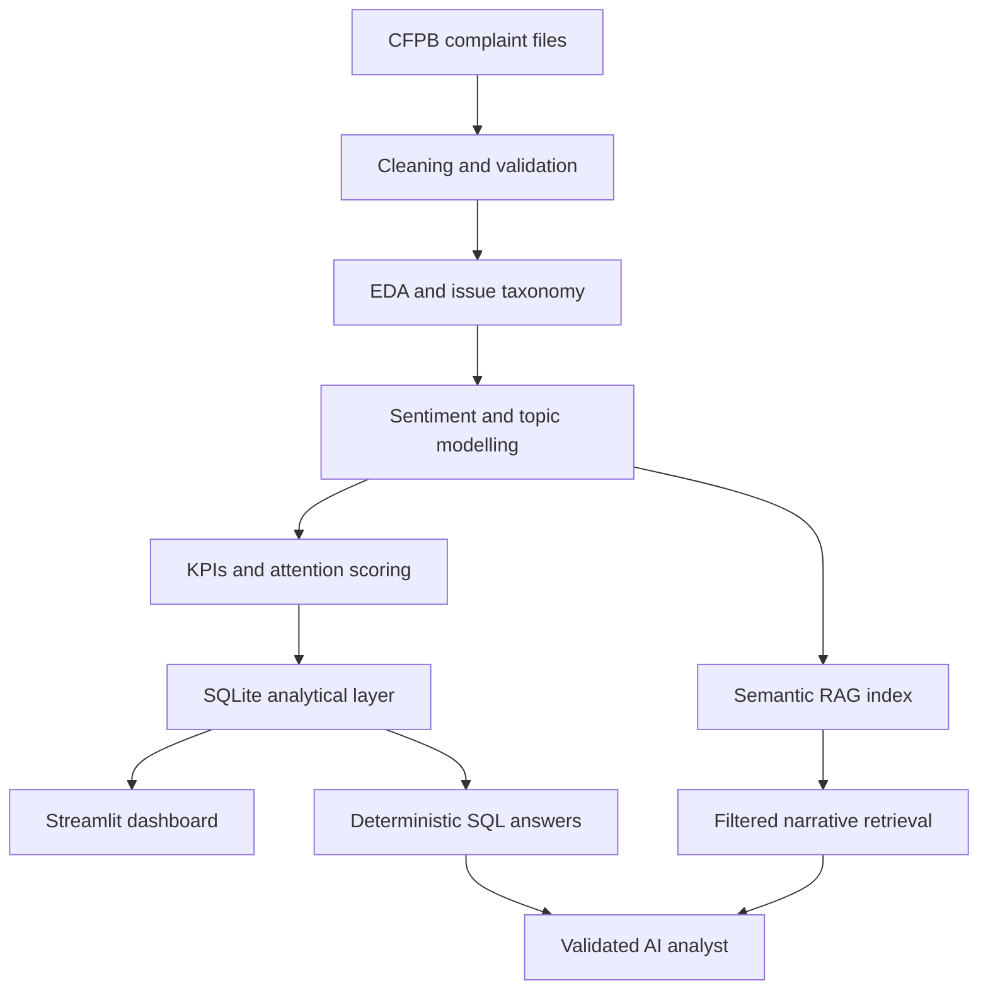
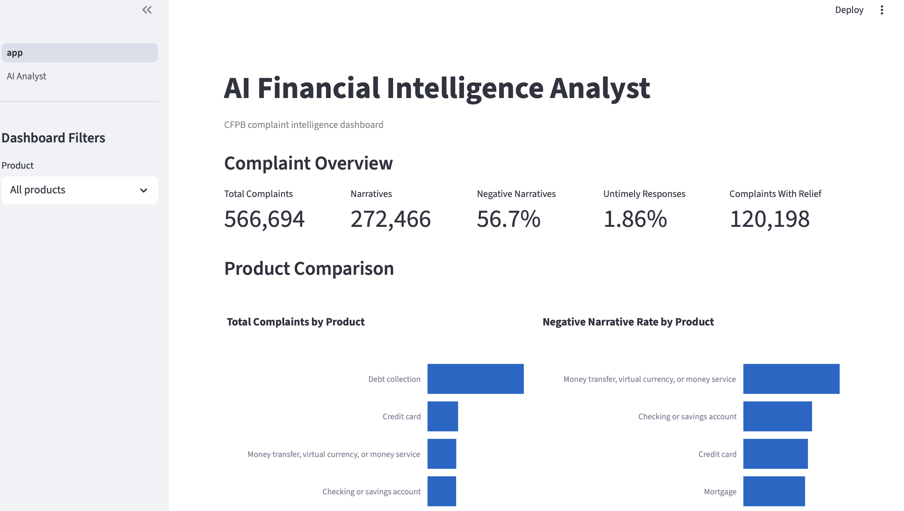
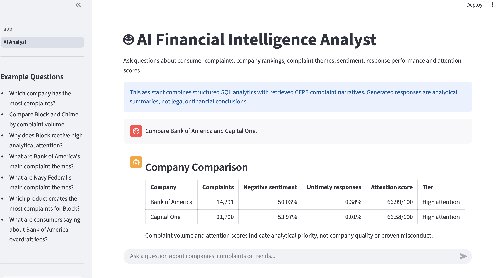
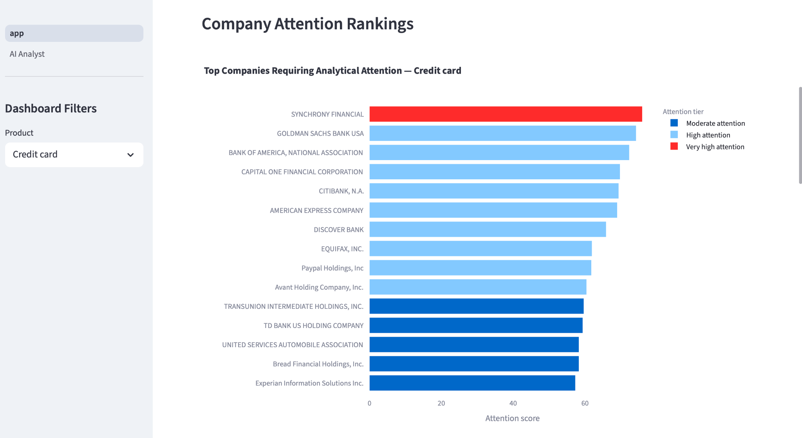

# AI Financial Intelligence Analyst

An end-to-end consumer-complaint intelligence platform built from the 2025
Consumer Financial Protection Bureau (CFPB) complaint data. The project combines
data engineering, exploratory analysis, financial KPI design, transformer-based
sentiment analysis, product-specific topic modelling, SQLite analytics,
Streamlit and a locally hosted hybrid SQL–RAG assistant.

## Project highlights

- Processed **566,694 complaints** across five financial-product categories.
- Analysed **272,466 consumer narratives**.
- Created an auditable issue taxonomy and product-specific complaint topics.
- Built company, product, response and attention KPIs in SQLite.
- Developed an interactive Streamlit dashboard for rankings and trends.
- Added a local AI analyst using deterministic SQL and filtered semantic search.
- Added validation rules that prevent swapped company values, unsupported
  statistics and unrelated narrative fallback.

## Why this project exists

Consumer complaint datasets are large, text-heavy and difficult to interpret
through raw tables alone. This project converts those records into structured
financial-intelligence views while retaining links to representative complaint
narratives.

The application is designed to answer questions such as:

- Which company has the most complaints?
- Which product creates the most complaints for a company?
- How do two companies compare on volume, sentiment and response performance?
- What are a company's main complaint themes?
- What do representative narratives say about a specific company and issue?

## Data scope

| Metric | Value |
|---|---:|
| Complaints | 566,694 |
| Complaints with narratives | 272,466 |
| Narrative coverage | 48.08% |
| Product categories | 5 |
| RAG documents | 13,066 |
| Embedding dimensions | 384 |

Products included:

- Checking or savings accounts
- Credit cards
- Debt collection
- Money transfers, virtual currency and money services
- Mortgages

## Architecture



See [docs/architecture.md](docs/architecture.md) for the detailed design.
## Application screenshots

### Intelligence dashboard



### AI analyst



### Company attention rankings



## Analytical workflow

| Stage | Notebook | Purpose |
|---|---|---|
| 1 | `01_data_ingestion_validation.ipynb` | Load and validate the product files |
| 2 | `02_data_cleaning.ipynb` | Standardise fields and create full/balanced datasets |
| 3 | `03_EDA.ipynb` | Analyse volume, geography, time and company patterns |
| 4 | `04_Issue_and_SubIssue_Taxonomy.ipynb` | Create the issue taxonomy |
| 5 | `05_Consumer_Narrative_Prep_NLP.ipynb` | Prepare and audit narrative text |
| 6 | `06_Sentiment_Analysis.ipynb` | Evaluate and apply sentiment models |
| 7 | `07_Topic_Modelling.ipynb` | Build product-specific topic models |
| 8 | `08_financial_intelligence_kpis.ipynb` | Calculate company and product KPIs |
| 9 | `09_sql_analytics_layer.ipynb` | Build SQLite tables, views and indexes |

## Hybrid SQL–RAG analyst

The assistant deliberately separates exact analytics from generated language:

1. **Intent and entity routing** detects companies, products, metrics and issues.
2. **Deterministic SQL templates** answer counts, rankings, percentages and
   company comparisons without giving numbers to the LLM.
3. **Filtered semantic retrieval** restricts narrative candidates by company,
   product and issue before cosine similarity is calculated.
4. **Local generation** uses Ollama only to summarise retrieved narrative text.
5. **Validation** rejects unknown complaint IDs, generated percentages and
   unsupported conclusions.

The RAG index uses `sentence-transformers/all-MiniLM-L6-v2` with 384-dimensional
embeddings. The default local generation model is `llama3.2` through Ollama.

## Reliability boundary

| Question type | Handling |
|---|---|
| Counts, rankings and percentages | Deterministic SQL |
| Multi-company comparisons | SQL plus fixed templates |
| Product drivers | SQL plus fixed templates |
| Company themes | SQL aggregation with neutral display labels |
| Narrative questions | Metadata-filtered RAG plus local LLM |
| Missing or ambiguous evidence | Clarification or explicit no-evidence response |

Complaint narratives are consumer-submitted allegations and are not proof of
misconduct. The attention score indicates analytical priority, not company
quality or regulatory guilt.

## Repository structure

```text
AIProject/
├── dashboard/
│   ├── app.py
│   └── pages/2_AI_Analyst.py
├── notebooks/
│   ├── 01_data_ingestion_validation.ipynb
│   └── ...
├── outputs/sql_analytics/
│   ├── financial_intelligence_schema.sql
│   └── financial_intelligence_queries.sql
├── rag/
│   ├── build_index.py
│   ├── config.py
│   ├── entities.py
│   ├── retrieval.py
│   ├── router.py
│   ├── sql_queries.py
│   ├── templates.py
│   └── validator.py
├── tests/test_analyst_core.py
├── requirements.txt
└── README.md
```

Large generated datasets, SQLite databases and embeddings are intentionally
excluded from version control.

## Local setup

The application was developed with Python 3.9+.

```bash
git clone <your-repository-url>
cd AIProject
python3 -m venv .venv
source .venv/bin/activate
python3 -m pip install --upgrade pip
python3 -m pip install -r requirements.txt
```

Install and start [Ollama](https://ollama.com/), then download the local model:

```bash
ollama pull llama3.2
```

The locally generated artifacts expected by the application are:

```text
outputs/sql_analytics/financial_intelligence.db
rag/rag_index/embeddings.npy
rag/rag_index/metadata.csv.gz
rag/rag_index/manifest.json
```

These can be rebuilt through the notebooks and `rag/build_index.py`.

## Run the application

```bash
python3 -m streamlit run dashboard/app.py
```

## Run tests

```bash
python3 -m unittest discover -s tests -v
python3 -m rag.smoke_test
```

## Example verified questions

```text
Which company has the most complaints?
Which has more complaints: Block or Chime Financial Inc?
Compare Bank of America and Capital One.
What is Bank of America's attention score?
What are Navy Federal's main complaint themes?
What are consumers saying about Bank of America overdraft fees?
```

## Key limitations

- CFPB submissions do not represent every customer or every interaction.
- Complaint volume is not adjusted for company customer base or market share.
- Sentiment and topic assignments are model-generated and may contain errors.
- Representative RAG documents do not reproduce the complete narrative corpus.
- Topic clusters can be broader than a narrowly worded user question.
- Generated narrative summaries remain illustrative and cite their retrieved
  complaint evidence.

## Responsible AI considerations

- Numerical answers remain under deterministic SQL control.
- The system avoids accusations of fraud, illegality or misconduct.
- Narrative evidence is labelled as unverified consumer allegation.
- Missing evidence does not trigger global or unrelated narrative fallback.
- Attention scores are presented as prioritisation signals rather than verdicts.

## Technology stack

Python · pandas · NumPy · SQLite · Plotly · Streamlit · PyTorch · FinBERT ·
Sentence Transformers · Ollama · local LLM · semantic retrieval

## Data source

Consumer Financial Protection Bureau —
[Consumer Complaint Database](https://www.consumerfinance.gov/data-research/consumer-complaints/)
