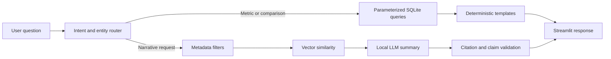

# Architecture and Design Decisions

## System overview

The project has two connected but intentionally separate analytical paths:

1. A deterministic path for facts that can be answered from structured data.
2. A retrieval-augmented path for questions requiring complaint narratives.

## Data layer

The SQLite database is the authoritative source for numerical results. Major
tables include:

- `complaints`
- `product_kpis`
- `company_kpis`
- `company_product_kpis`
- `company_product_attention`
- `company_rankings`
- `issue_severity_kpis`

The database also provides analytical views for product trends, topic hotspots
and company attention rankings. Indexes support company, product, month, issue,
topic and sentiment filtering.

## Attention metrics

Attention scores prioritise entities for further analysis. They combine stored
complaint-related indicators at company-product and overall-company levels.
They are not credit scores, customer-satisfaction scores or findings of
wrongdoing. Ranking comparisons use the database's
`eligible_for_comparison` flag.

## RAG index

The narrative index contains 13,066 representative documents sampled across
product-company-topic groups. Each document is embedded using
`sentence-transformers/all-MiniLM-L6-v2` into a 384-dimensional vector.

The retriever:

1. Resolves official company names.
2. Applies exact company and product filters.
3. Requires requested issue evidence in structured metadata and narrative text.
4. Normalises stored and query vectors.
5. Calculates cosine similarity only over surviving candidates.
6. Returns no examples when the filtered candidate set is empty.

## Response routing

| Intent | Source | Rendering |
|---|---|---|
| Global company ranking | `company_rankings` | Fixed template |
| Direct company metric | `company_rankings` | Fixed template |
| Company comparison | `company_rankings` | Fixed table and comparison |
| Product driver | `company_product_attention` | Fixed table |
| Main themes | `complaints` aggregation | Fixed ordered list |
| Narrative question | RAG index | Local LLM plus validator |

This design prevents the LLM from calculating, reordering or rewriting critical
numbers.

## Validation controls

- SQL columns and sort directions are allow-listed.
- Query values use parameterized SQL.
- Every requested company must be resolved before comparison.
- Narrative summaries may cite only retrieved complaint IDs.
- Generated narrative percentages are rejected.
- Unsupported recommendations and allegations are rejected.
- Company-heavy topic prefixes are neutralised only at display time; the source
  database remains unchanged.

## Known limitations

- Product-specific topic clusters may still group adjacent issues.
- Semantic retrieval quality depends on the representative indexed sample.
- Local generation quality depends on the installed Ollama model.
- Database and index artifacts are too large for ordinary Git hosting and must
  be rebuilt or distributed separately.
